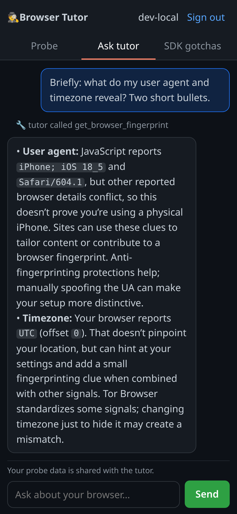
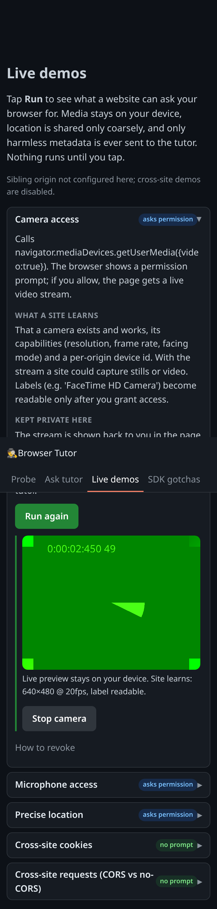
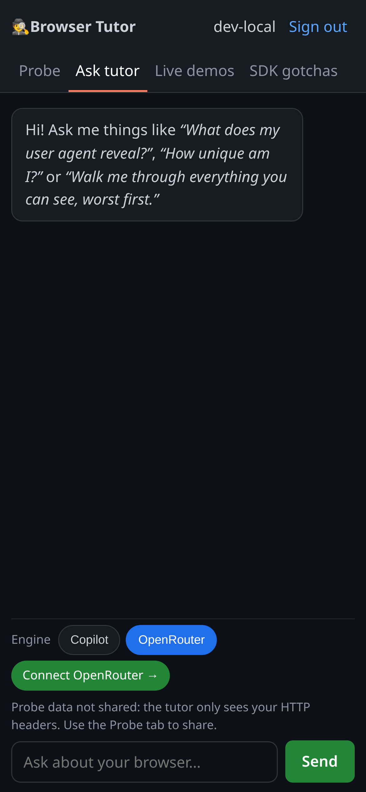
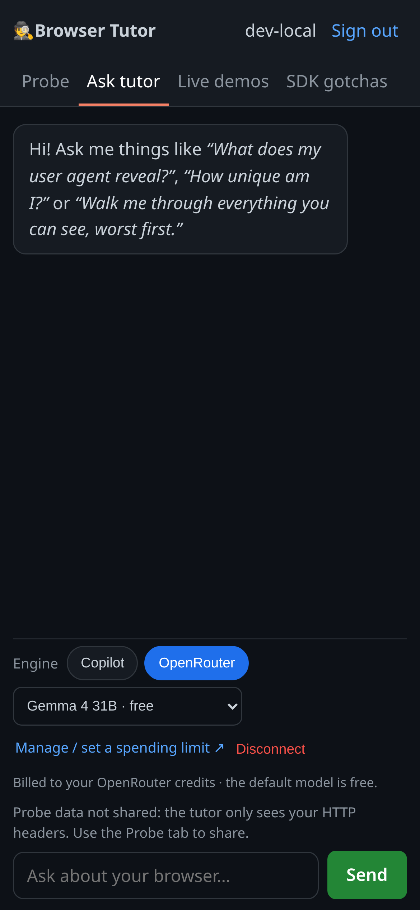

# Browser Tutor — GitHub Copilot SDK PoC

A small, security-focused web app: **sign in with GitHub → see exactly what your own browser exposes to any
website** (HTTP headers *and* JavaScript APIs) → **chat with a [GitHub Copilot SDK](https://github.com/github/copilot-sdk)
agent** that explains each signal, how it is used for tracking and fingerprinting, what a curious or malicious site
could do with it, and how to defend yourself. There are also **live, tap-to-run permission demos** (camera, mic,
geolocation, cookies, cross-site requests, and a **storage inspector** that shows where your chat is saved) and an **"Agent SDK gotchas"** lesson about safely building agents like this one.

After signing in you pick a **model engine**: **GitHub Copilot** (runs on *your* Copilot subscription) or **OpenRouter** (runs on
*your* OpenRouter credits via OAuth PKCE — so a user **without** Copilot can still use the tutor, and the operator never pays for
your inference or handles a raw API key). Both engines share the exact same tools, `run_demo`, permission allow-list, `mode:"empty"`
hardening and streaming.

Educational and defensive only. Nothing here attacks anyone; every "demo" runs against *your own* browser and reports
only metadata back to the tutor.

> **Live demo:** https://copilot-sdk.demo.curiosta.com — sign-in is currently limited to invited GitHub accounts
> (`ALLOWED_LOGINS`) — GitHub sign-in is the identity gate. Each user then runs on **their own** GitHub Copilot entitlement
> **or** their own OpenRouter credits (default model is free).

| Probe & chat | Live demos | SDK gotchas |
|---|---|---|
|  |  |  |

| Pick your engine | OpenRouter connected |
|---|---|
|  |  |

## What it teaches

- **Passive signals** the server sees with no JavaScript at all: IP, `User-Agent`, `Accept-Language`, `sec-ch-*`, TLS/HTTP facts.
- **Active signals** JavaScript can read: screen, timezone, languages, canvas/WebGL hashes, fonts, media-device counts, permission states.
- **Permissioned capabilities** via the live demos: camera, microphone, geolocation (all local-only; only metadata is reported),
  and **cross-site behaviour** against a genuinely separate "sibling" origin (CORS vs no-CORS reads, and a shared-parent cookie).
- **Script injection (contained XSS lab)**: a `run_demo` `xss_lab` demo embeds a deliberately vulnerable mini-site on a dedicated,
  isolated origin (`xss-lab.demo.curiosta.com`) and shows reflected/stored/DOM XSS, what injected script can do, the defences (escaping,
  DOMPurify, strict CSP + `securitypolicyviolation`, HttpOnly, scheme checks, Trusted Types), and prompt-injection-to-XSS — each with a
  vulnerable vs fixed variant. It is isolated so curiosta.com never becomes a real XSS/phishing host (own origin, host-only session
  cookie, no URL-borne payloads, only usable when framed by the app, echo-only exfiltration).
- **Where your data lives in the browser**: a `storage_inspector` demo shows this site's own localStorage (including the saved chat
  transcript — key name, size, message count, expiry), sessionStorage, IndexedDB and the JS-visible cookies (the HttpOnly `bt_sess`
  session cookie is deliberately absent), plus quota via `navigator.storage.estimate()` — and explains cookies vs Web Storage, origin
  scope, and eviction. Only metadata is shared with the tutor, never content.
- **How to defend**: browser choice/settings, resistFingerprinting, 3rd-party-cookie blocking, GPC, permission hygiene, and the trade-offs.

## Architecture

```
                         ┌──────────────────── AWS ────────────────────┐
Browser ──HTTPS──> CloudFront ──(X-Origin-Verify secret header)──> Lambda Function URL (RESPONSE_STREAM)
  │  probe.js / demos.js: static, reviewed client code only          │   └─ Lambda Web Adapter ─> Node http server (src/server.mjs)
  │  POST /api/chat  (Server-Sent Events stream)                      │        │
  ▼                                                                   │        ▼
 sibling.<domain> ── second CloudFront dist, same Lambda ──┘          │   Copilot SDK client  mode:"empty", useLoggedInUser:false
                                                                      │     per-user session: gitHubToken = the user's OAuth token
 Secrets Manager (client_id, client_secret, session_secret,          │     availableTools:["custom:*"] → only 4 read-only tools
                  origin_verify) ── read at runtime, never in env ────┘     JSON-RPC/stdio ─> bundled copilot-runtime child process
                                                                            ├─> GitHub Copilot API (billed to that user's Copilot plan)
                                                                            └─> OpenRouter BYOK provider (OpenAI-compatible,
                                                                                base URL hard-allowlisted; billed to the user's credits)
```

- **Lambda (zip, nodejs22.x) + [Lambda Web Adapter](https://github.com/awslabs/aws-lambda-web-adapter)** runs the plain Node server with response streaming; a **Function URL** gives it HTTPS.
- **CloudFront** adds the custom domain and TLS, forwards viewer facts (bundled into one header to stay within the 10-header limit),
  and injects a secret **`X-Origin-Verify`** header so the origin rejects anyone hitting the Function URL directly (gotcha 9).
- **Secrets Manager** holds *all* secrets as one JSON; **no secret is in Lambda env vars**.
- **Two model engines, one code path**: the Copilot engine passes the user's GitHub token per session; the **OpenRouter** engine
  uses the Copilot SDK's **BYOK `ProviderConfig`** (`type:"openai"`, `baseUrl` hard-coded to `https://openrouter.ai/api/v1`) with the
  user's `sk-or-` key — a session with a provider bypasses Copilot auth, so Copilot is not required. Switching engine/model rebuilds the session.
- **Sessions are stateless**: an AES-256-GCM encrypted `HttpOnly` cookie carries the login, the (refreshable) GitHub token and,
  if connected, the OpenRouter key, so any Lambda instance can serve any user. When a request lands on a cold instance, the browser-held transcript is replayed.

## Security notes

This project is itself a worked example of building an agent safely. The **[`/gotchas`](https://copilot-sdk.demo.curiosta.com/gotchas)**
page (source: [`src/gotchas.mjs`](src/gotchas.mjs)) lists 17 pitfalls of the Copilot SDK with a **status** (Fixed / Mitigated /
Accepted / Needs human) and a pointer to the code that handles each. Highlights:

- **No model-generated JavaScript.** The model only returns text; live demos use a `run_demo` **enum** that maps a demo *name*
  to pre-written, reviewed client code. Model Markdown is rendered with a vendored, self-hosted parser (`marked`) and sanitized with
  `DOMPurify` (served from `/static`): raw HTML, `<script>`, `` and `javascript:`/`data:` links are stripped and links are
  forced to http/https with `rel=noopener noreferrer`. Suggested-question chips come from a structured `suggest_followups` tool and are
  rendered as `textContent` only. CSP is
  `script-src 'self'` with no `unsafe-inline`/`unsafe-eval`.
- **Prompt-injection defence.** Every tool result is wrapped in `<<<BEGIN_UNTRUSTED_DATA>>> … <<<END_UNTRUSTED_DATA>>>` markers,
  length-capped and control-char-stripped, and the system prompt treats anything inside as data, never instructions. Tools are
  read-only. (Reduces, does not eliminate, the risk — see `scripts/injection-tests.mjs`.)
- **Multi-tenant by construction.** Every Copilot client is built through a helper that **throws unless `mode:"empty"`**; each
  session exposes only this app's 4 read-only tools. No shell/file/web/MCP tools exist.
- **Per-user auth, no server-wide fallback.** `useLoggedInUser:false` + a per-session token/`gitHubTokenProvider`. The only
  ambient-credential path is the localhost dev bypass, which **hard-fails at startup under `NODE_ENV=production`**.
- **Token refresh.** The `ghr_` refresh token lives only in the encrypted cookie; the access token is refreshed before expiry;
  refresh failure logs the user out cleanly. Session capped at 7 days.
- **Deny-by-default permissions** and **secret masking** (cookies, tokens, the origin secret, `sk-or-` keys never reach the model or logs).
- **User-paid keys handled as credentials (OpenRouter).** The `sk-or-` key lives only in the encrypted cookie; it is never logged
  (the scrubber redacts `sk-or-` too), never sent to the model or client JS, and a Disconnect action drops it and links the user to revoke it.
  The base URL is a hard-coded constant (no user-supplied base URL → no SSRF); the default model is OpenRouter's **Auto** router (`openrouter/auto`), which may route to paid models (shown as an honest note in the picker) — free `:free` tool-calling models are one tap away,
  and the UI deep-links the user to set a spending limit. Consumer-subscription logins (ChatGPT, Claude.ai) are deliberately **not**
  offered server-side; OpenRouter's user-owned-key OAuth is the sanctioned "user pays" path.

See the page for the full list and the exact files.

## Model engines (who pays)

| Engine | Who pays | Login | Needs Copilot? |
|---|---|---|---|
| **GitHub Copilot** | the signed-in user's Copilot plan | GitHub OAuth (identity gate) | yes |
| **OpenRouter** | the signed-in user's OpenRouter credits | GitHub OAuth **+** OpenRouter OAuth PKCE | no |

OpenRouter uses **OAuth PKCE (S256)**: the app redirects to `https://openrouter.ai/auth`, exchanges the returned code
server-side at `https://openrouter.ai/api/v1/auth/keys`, and stores the resulting user-owned `sk-or-` key **only** in the
encrypted session cookie. There is **no client secret and no extra AWS secret** (PKCE needs none). GitHub sign-in stays the
identity gate (`ALLOWED_LOGINS`); OpenRouter is a *model-provider connection*, not a standalone login — making it standalone
would bypass the allow-list and open the app to anyone with an OpenRouter account. Default model is a free, tool-calling
`openrouter/auto` router by default (with a clear paid-routing note); the curated list keeps free `:free` models one tap away because tool calling is required.


## Client-side chat widget (static-site pilot)

`/widget/` is a pilot of a **framework-free, backend-free chat widget** you can drop into any static site (e.g. GitHub Pages) with a single `<script>` tag. There are **zero calls back to this server**: the widget runs OpenRouter OAuth PKCE (S256) in the browser, holds the issued `sk-or` key in **sessionStorage only** (cleared on tab close; **Disconnect** wipes it), and calls `https://openrouter.ai/api/v1/chat/completions` directly with streaming (default `openrouter/auto`, free models in the picker). Replies render through the same vendored **marked + DOMPurify** pipeline (never raw `innerHTML`).

It is **page-aware and site-aware**: it sends the current page's visible text (capped, control-chars stripped, delimited as data) and does lightweight in-browser **BM25 retrieval** over a build-time `site-index.json`, sending the top chunks and **citing the source pages as links**. It is isolated from the tutor's own server-side OpenRouter session — it uses its own `btw_*` storage keys and never touches `bt_sess` or `bt_chat`, and it is deliberately **not** GitHub-gated (the realistic static-site case). The only cost exposure is the visitor's own key.

**Security on a header-less host.** The pilot pages ship a strict **meta-tag CSP** (`script-src 'self'; connect-src 'self' https://openrouter.ai`; no `unsafe-inline`/`eval`), so the widget uses a single external `widget.js` + `widget.css`, no inline handlers or styles, and no third-party scripts. A `<meta>` CSP **cannot** express `frame-ancestors` or `report-uri` — those still need a real header where the host allows it (this server also sends the CSP as a header, with `frame-ancestors`, as defence in depth). See the `client-side-byok-key` gotcha.

**Embed it on your own GitHub Pages site.** Copy `widget.js`, `widget.css` and `vendor/` (marked + DOMPurify) into one folder, then add:

```html
<script src="/assets/widget.js"
        data-site-name="My Docs"
        data-context-selector="article"
        data-default-model="openrouter/auto"
        data-index="/site-index.json"></script>
```

`data-index` is optional (omit it for current-page-only answers). Build the index at deploy time:

```bash
node scripts/build-site-index.mjs ./_site --base / --out ./_site/site-index.json
```

In **GitHub Actions**, run that step after your static build and before publishing, e.g.:

```yaml
- name: Build site
  run: <your static build, e.g. jekyll/hugo/vite>   # outputs ./_site
- name: Build chat index
  run: node scripts/build-site-index.mjs ./_site --base / --out ./_site/site-index.json
- uses: actions/upload-pages-artifact@v3
  with: { path: ./_site }
```

The script is dependency-free (plain Node), so no extra `npm install` is needed. Recommended CSP `<meta>` for the host pages:

```html
<meta http-equiv="Content-Security-Policy"
      content="default-src 'none'; script-src 'self'; style-src 'self'; connect-src 'self' https://openrouter.ai; img-src 'self' data:; base-uri 'none'; form-action 'none'">
```

## Run locally

```bash
npm ci
cp .env.example .env     # fill GITHUB_CLIENT_ID / GITHUB_CLIENT_SECRET / SESSION_SECRET
                         # OAuth callback = http://localhost:8080/auth/callback
set -a; . ./.env; set +a
npm start                # http://localhost:8080  (a sibling origin also starts on SIBLING_PORT for the cross-site demos)
```

Or, on localhost only, skip OAuth and use this machine's own Copilot auth chain (env token / `copilot` login / `gh auth`):

```bash
npm run dev              # then open http://localhost:8080 and "Continue without OAuth (dev bypass)"
```

### Tests

```bash
node scripts/unit-tests.mjs        # mode:"empty" assertion + deny-by-default permission handler
node scripts/injection-tests.mjs   # prompt-injection vectors (UA, Referer, cookie name) are neutralised; secret masking
node scripts/openrouter-e2e.mjs    # mocked OpenRouter PKCE: login params, state rejection, exchange, key never exposed, disconnect
node scripts/markdown-xss.mjs      # model output with <script>//javascript: links is neutralised (marked + DOMPurify)
node scripts/xss-lab-e2e.mjs       # XSS lab: payloads fire in vuln variants, blocked in fixed; isolation, frame-ancestors, no URL payloads (needs the lab origin on LAB_PORT)
node scripts/widget-unit.mjs       # client-side widget: PKCE S256, BM25 retrieval, page-text cleaning, delimited context builder
node scripts/widget-e2e.mjs        # widget pilot /widget/: loads under the meta CSP with zero violations; mocked OpenRouter connect -> chat stream (cited) -> disconnect wipes storage
node scripts/e2e-mobile.mjs        # responsive checks at 360/390/768/1280 (needs: npm i --no-save puppeteer-core@23)
```

## Deploy (AWS)

All config is parameterised — nothing in this repo is tied to a specific AWS account or domain.

1. **Create the secret** (one JSON with everything) and export its ARN:
   ```bash
   aws secretsmanager create-secret --name browser-tutor/github-oauth --region "$AWS_REGION" \
     --secret-string "$(jq -n --arg ci "$GITHUB_CLIENT_ID" --arg cs "$GITHUB_CLIENT_SECRET" \
        --arg ss "$(openssl rand -hex 32)" --arg ov "$(openssl rand -hex 32)" \
        '{client_id:$ci, client_secret:$cs, session_secret:$ss, origin_verify:$ov}')"
   export GITHUB_OAUTH_SECRET_ARN=<arn>
   ```
2. **(Optional) custom domain:** deploy `deploy/cert-template.yaml` in **us-east-1** to get the ACM cert(s) for your
   main and sibling domains, then set `DOMAIN_NAME`, `CERTIFICATE_ARN`, `HOSTED_ZONE_ID`, and the `SIBLING_*` / `COOKIE_DOMAIN` vars.
3. **Deploy:**
   ```bash
   set -a; . ./.deploy-secrets; set +a   # gitignored; holds AWS_REGION, GITHUB_OAUTH_SECRET_ARN, domain/cert/zone vars …
   ./deploy/deploy.sh                     # builds dist/ (linux-x64 only) and runs `sam deploy`
   ```
   First deploy has no `BASE_URL` yet; grab the Function URL / site URL from the stack outputs, set `BASE_URL`
   (and your OAuth app's callback), and deploy again.

`deploy/build.sh` produces `dist/browser-tutor.zip` trimmed to the linux-x64 runtime (~184 MB unzipped; Lambda limit 250 MB).
Teardown: `sam delete --stack-name browser-tutor --region "$AWS_REGION"`. See `docs/HOSTING.md` for the cost notes
(designed to sit within a few dollars/month; a `$5/month` budget alert is recommended).

## Project layout

```
src/        server.mjs (routing, OAuth, sessions, origin lockdown, chat SSE), agent.mjs (SDK wiring, tools,
            refresh, sanitation), openrouter.mjs (OAuth PKCE + BYOK provider), appsecrets.mjs, serverview.mjs, prompt.mjs, gotchas.mjs, demos.mjs
public/     static UI (index/app/demos/gotchas .html, probe.js, demos.js, chat.js, render.js, style.css)
            widget.js + widget.css + widget/ (client-side OpenRouter chat widget pilot, site-index.json)
deploy/     template.yaml (SAM), cert-template.yaml, build.sh, deploy.sh, run.sh
scripts/    unit-tests, injection-tests, e2e-*
docs/       HOSTING.md, RESEARCH.md, screenshots
```

## License

[MIT](LICENSE) © 2026 Manoj Kumar Sahukar. The GitHub Copilot SDK is MIT-licensed; its bundled runtime binary is **not**
committed here (installed via `npm`). See [THIRD-PARTY-NOTICES.md](THIRD-PARTY-NOTICES.md).
