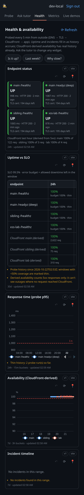
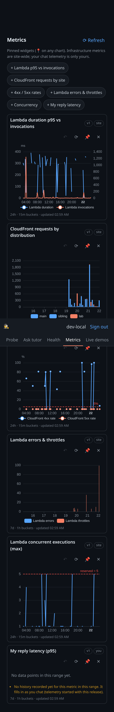
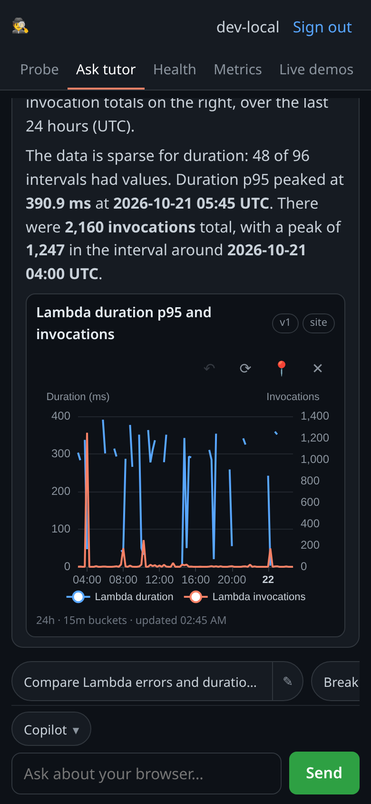
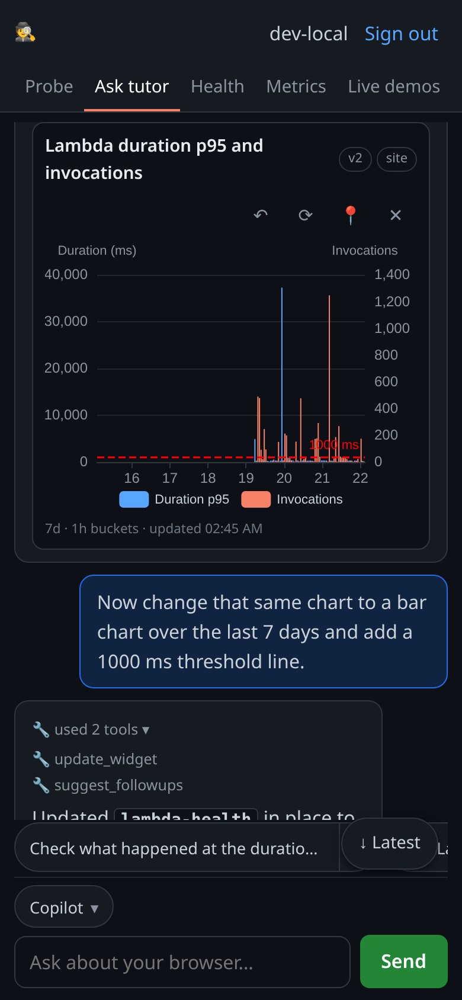

# Browser Tutor — GitHub Copilot SDK PoC

A small, security-focused web app: **sign in with GitHub → see exactly what your own browser exposes to any
website** (HTTP headers *and* JavaScript APIs) → **chat with a [GitHub Copilot SDK](https://github.com/github/copilot-sdk)
agent** that explains each signal, how it is used for tracking and fingerprinting, what a curious or malicious site
could do with it, and how to defend yourself. There are also **live, tap-to-run permission demos** (camera, mic,
geolocation, cookies, cross-site requests, and a **storage inspector** that shows where your chat is saved) and an **"Agent SDK gotchas"** lesson about safely building agents like this one.

After signing in you pick a **model engine**: **GitHub Copilot** (runs on *your* Copilot subscription) or **OpenRouter** (runs on
*your* OpenRouter credits via OAuth PKCE — so a user **without** Copilot can still use the tutor, and the operator never pays for
your inference or handles a raw API key). Both engines share the exact same tools, `run_demo`, permission allow-list, `mode:"empty"`
hardening and streaming.

Educational and defensive only. Nothing here attacks anyone; every "demo" runs against *your own* browser and reports
only metadata back to the tutor.

> **Live demo:** https://copilot-sdk.demo.curiosta.com — sign-in is currently limited to invited GitHub accounts
> (`ALLOWED_LOGINS`) — GitHub sign-in is the identity gate. Each user then runs on **their own** GitHub Copilot entitlement
> **or** their own OpenRouter credits (default model is free).

| Probe & chat | Live demos | SDK gotchas |
|---|---|---|
|  |  |  |

| Pick your engine | OpenRouter connected |
|---|---|
|  |  |

## What it teaches

- **Passive signals** the server sees with no JavaScript at all: IP, `User-Agent`, `Accept-Language`, `sec-ch-*`, TLS/HTTP facts.
- **Active signals** JavaScript can read: screen, timezone, languages, canvas/WebGL hashes, fonts, media-device counts, permission states.
- **Permissioned capabilities** via the live demos: camera, microphone, geolocation (all local-only; only metadata is reported),
  and **cross-site behaviour** against a genuinely separate "sibling" origin (CORS vs no-CORS reads, and a shared-parent cookie).
- **Script injection (contained XSS lab)**: a `run_demo` `xss_lab` demo embeds a deliberately vulnerable mini-site on a dedicated,
  isolated origin (`xss-lab.demo.curiosta.com`) and shows reflected/stored/DOM XSS, what injected script can do, the defences (escaping,
  DOMPurify, strict CSP + `securitypolicyviolation`, HttpOnly, scheme checks, Trusted Types), and prompt-injection-to-XSS — each with a
  vulnerable vs fixed variant. It is isolated so curiosta.com never becomes a real XSS/phishing host (own origin, host-only session
  cookie, no URL-borne payloads, only usable when framed by the app, echo-only exfiltration).
  Four further lessons (`run_demo` `xss_lab` with `lesson=`), each vulnerable vs fixed and launched only by a tap on a curated preset:
  - `links` **Sneaky links**: a naive "starts with `/` or `http`" check vs the strict `safeHref` filter, over `//evil.example`,
    `/\evil.example`, `javascript:`, `data:`, a tab inside the scheme, leading spaces and a control character. Each row shows the
    resolved destination (`new URL(href, page)`); nothing navigates.
  - `hooks` **Shared sanitiser hooks**: script A adds a permissive `uponSanitizeAttribute` hook (force-keeps `onerror`) to the
    shared global DOMPurify and script B's `sanitize()` lets `` run; fixed by giving A a private `DOMPurify(window)`.
  - `csp3p` **CSP with third parties**: a Giscus-style embed under a `<meta>` CSP. The tight policy refuses the real `giscus.app`
    script, stylesheet and iframe before any request (each raises `securitypolicyviolation`, reported in the lab); the
    recommended Giscus policy (see the widget section) admits same-origin stand-ins with zero violations, so the lab never calls
    a third party. Explains that a meta CSP cannot set `frame-ancestors`, `report-uri`/`report-to` or `sandbox`.
  - `keystore` **Where your API key lives**: a DUMMY `sk-or-v1-LABDUMMY-…` key in sessionStorage (tab-only) and in a 7-day
    localStorage "remember"; an injected preset reads both, and a simulated new tab shows which survives (gotcha `client-side-byok-key`).
- **Where your data lives in the browser**: a `storage_inspector` demo shows this site's own localStorage (including the saved chat
  transcript — key name, size, message count, expiry), sessionStorage, IndexedDB and the JS-visible cookies (the HttpOnly `bt_sess`
  session cookie is deliberately absent), plus quota via `navigator.storage.estimate()` — and explains cookies vs Web Storage, origin
  scope, and eviction. Only metadata is shared with the tutor, never content.
- **How to defend**: browser choice/settings, resistFingerprinting, 3rd-party-cookie blocking, GPC, permission hygiene, and the trade-offs.

## Architecture

```
                         ┌──────────────────── AWS ────────────────────┐
Browser ──HTTPS──> CloudFront ──(X-Origin-Verify secret header)──> Lambda Function URL (RESPONSE_STREAM)
  │  probe.js / demos.js: static, reviewed client code only          │   └─ Lambda Web Adapter ─> Node http server (src/server.mjs)
  │  POST /api/chat  (Server-Sent Events stream)                      │        │
  ▼                                                                   │        ▼
 sibling.<domain> ── second CloudFront dist, same Lambda ──┘          │   Copilot SDK client  mode:"empty", useLoggedInUser:false
                                                                      │     per-user session: gitHubToken = the user's OAuth token
 Secrets Manager (client_id, client_secret, session_secret,          │     availableTools:["custom:*"] → only 4 read-only tools
                  origin_verify) ── read at runtime, never in env ────┘     JSON-RPC/stdio ─> bundled copilot-runtime child process
                                                                            ├─> GitHub Copilot API (billed to that user's Copilot plan)
                                                                            └─> OpenRouter BYOK provider (OpenAI-compatible,
                                                                                base URL hard-allowlisted; billed to the user's credits)
```

- **Lambda (zip, nodejs22.x) + [Lambda Web Adapter](https://github.com/awslabs/aws-lambda-web-adapter)** runs the plain Node server with response streaming; a **Function URL** gives it HTTPS.
- **CloudFront** adds the custom domain and TLS, forwards viewer facts (bundled into one header to stay within the 10-header limit),
  and injects a secret **`X-Origin-Verify`** header so the origin rejects anyone hitting the Function URL directly (gotcha 9).
- **Secrets Manager** holds *all* secrets as one JSON; **no secret is in Lambda env vars**.
- **Two model engines, one code path**: the Copilot engine passes the user's GitHub token per session; the **OpenRouter** engine
  uses the Copilot SDK's **BYOK `ProviderConfig`** (`type:"openai"`, `baseUrl` hard-coded to `https://openrouter.ai/api/v1`) with the
  user's `sk-or-` key — a session with a provider bypasses Copilot auth, so Copilot is not required. Switching engine/model rebuilds the session.
- **Sessions are stateless**: an AES-256-GCM encrypted `HttpOnly` cookie carries the login, the (refreshable) GitHub token and,
  if connected, the OpenRouter key, so any Lambda instance can serve any user. When a request lands on a cold instance, the browser-held transcript is replayed.

## Security notes

This project is itself a worked example of building an agent safely. The **[`/gotchas`](https://copilot-sdk.demo.curiosta.com/gotchas)**
page (source: [`src/gotchas.mjs`](src/gotchas.mjs)) lists 23 pitfalls of the Copilot SDK with a **status** (Fixed / Mitigated /
Accepted / Needs human) and a pointer to the code that handles each. The
**[`/architecture`](https://copilot-sdk.demo.curiosta.com/architecture)** page has four inline-SVG diagrams (request flow,
sign-in and tokens, the agent's tool loop, trust boundaries) plus a threat-to-control table. Highlights:

- **No model-generated JavaScript.** The model only returns text; live demos use a `run_demo` **enum** that maps a demo *name*
  to pre-written, reviewed client code. Model Markdown is rendered with a vendored, self-hosted parser (`marked`) and sanitized with
  `DOMPurify` (served from `/static`): raw HTML, `<script>`, `` and `javascript:`/`data:` links are stripped and links are
  forced to http/https with `rel=noopener noreferrer`. Suggested-question chips come from a structured `suggest_followups` tool and are
  rendered as `textContent` only. CSP is
  `script-src 'self'` with no `unsafe-inline`/`unsafe-eval`.
- **Prompt-injection defence.** Every tool result is wrapped in `<<<BEGIN_UNTRUSTED_DATA>>> … <<<END_UNTRUSTED_DATA>>>` markers,
  length-capped and control-char-stripped, and the system prompt treats anything inside as data, never instructions. Tools are
  read-only. (Reduces, does not eliminate, the risk — see `scripts/injection-tests.mjs`.)
- **Multi-tenant by construction.** Every Copilot client is built through a helper that **throws unless `mode:"empty"`**; each
  session exposes only this app's 4 read-only tools. No shell/file/web/MCP tools exist.
- **Per-user auth, no server-wide fallback.** `useLoggedInUser:false` + a per-session token/`gitHubTokenProvider`. The only
  ambient-credential path is the localhost dev bypass, which **hard-fails at startup under `NODE_ENV=production`**.
- **Token refresh.** The `ghr_` refresh token lives only in the encrypted cookie; the access token is refreshed before expiry;
  refresh failure logs the user out cleanly. Session capped at 7 days.
- **Deny-by-default permissions** and **secret masking** (cookies, tokens, the origin secret, `sk-or-` keys never reach the model or logs).
- **User-paid keys handled as credentials (OpenRouter).** The `sk-or-` key lives only in the encrypted cookie; it is never logged
  (the scrubber redacts `sk-or-` too), never sent to the model or client JS, and a Disconnect action drops it and links the user to revoke it.
  The base URL is a hard-coded constant (no user-supplied base URL → no SSRF); the default model is OpenRouter's **Auto** router (`openrouter/auto`), which may route to paid models (shown as an honest note in the picker) — free `:free` tool-calling models are one tap away,
  and the UI deep-links the user to set a spending limit. Consumer-subscription logins (ChatGPT, Claude.ai) are deliberately **not**
  offered server-side; OpenRouter's user-owned-key OAuth is the sanctioned "user pays" path.

See the page for the full list and the exact files.

## Model engines (who pays)

| Engine | Who pays | Login | Needs Copilot? |
|---|---|---|---|
| **GitHub Copilot** | the signed-in user's Copilot plan | GitHub OAuth (identity gate) | yes |
| **OpenRouter** | the signed-in user's OpenRouter credits | GitHub OAuth **+** OpenRouter OAuth PKCE | no |

OpenRouter uses **OAuth PKCE (S256)**: the app redirects to `https://openrouter.ai/auth`, exchanges the returned code
server-side at `https://openrouter.ai/api/v1/auth/keys`, and stores the resulting user-owned `sk-or-` key **only** in the
encrypted session cookie. There is **no client secret and no extra AWS secret** (PKCE needs none). GitHub sign-in stays the
identity gate (`ALLOWED_LOGINS`); OpenRouter is a *model-provider connection*, not a standalone login — making it standalone
would bypass the allow-list and open the app to anyone with an OpenRouter account. Default model is a free, tool-calling
`openrouter/auto` router by default (with a clear paid-routing note); the curated list keeps free `:free` models one tap away because tool calling is required.


## Client-side chat widget (static-site pilot)

`/widget/` is a pilot of a **framework-free, backend-free chat widget** you can drop into any static site (e.g. GitHub Pages) with a single `<script>` tag. There are **zero calls back to this server**: the widget runs OpenRouter OAuth PKCE (S256) in the browser, holds the issued `sk-or` key in **sessionStorage** by default (cleared on tab close; **Disconnect** wipes it; opt-in *Remember on this device* keeps a 7-day copy in localStorage). The PKCE verifier + state sit in localStorage for ≤10 minutes, one-time, so the OAuth return still works when it lands in a new tab/Custom Tab on Android; add `?btw_debug=1` to see the callback steps (never the code or key), and calls `https://openrouter.ai/api/v1/chat/completions` directly with streaming (default `openrouter/free` = *Auto (free models only)*; *Auto (best available)* `openrouter/auto` and individual free models stay in the picker). Replies render through the same vendored **marked + DOMPurify** pipeline (never raw `innerHTML`).

It is **page-aware and site-aware**: it sends the current page's visible text (capped, control-chars stripped, delimited as data) and does lightweight in-browser **BM25 retrieval** over a build-time `site-index.json`, sending the top chunks and **citing the source pages as links**. It is isolated from the tutor's own server-side OpenRouter session — it uses its own `btw_*` storage keys and never touches `bt_sess` or `bt_chat`, and it is deliberately **not** GitHub-gated (the realistic static-site case). The only cost exposure is the visitor's own key.

**Security on a header-less host.** The pilot pages ship a strict **meta-tag CSP** (`script-src 'self'; connect-src 'self' https://openrouter.ai`; no `unsafe-inline`/`eval`), so the widget uses a single external `widget.js` + `widget.css`, no inline handlers or styles, and no third-party scripts. A `<meta>` CSP **cannot** express `frame-ancestors` or `report-uri` — those still need a real header where the host allows it (this server also sends the CSP as a header, with `frame-ancestors`, as defence in depth). See the `client-side-byok-key` gotcha.

**Embed it on your own GitHub Pages site.** Copy `widget.js`, `widget.css` and `vendor/` (marked + DOMPurify) into one folder, then add:

```html
<script src="/assets/widget.js"
        data-site-name="My Docs"
        data-context-selector="article"
        data-default-model="openrouter/free"
        data-index="/site-index.json"></script>
```

`data-index` is optional (omit it for current-page-only answers). Optional per-site settings (all plain text; omit for defaults):

| Attribute | What it does | Default |
|---|---|---|
| `data-persona` | Extra system-prompt guidance from the site owner (role, tone, safety lines), appended **after** the core grounding/anti-injection rules; ≤ 2000 chars | none |
| `data-suggestions` | JSON array of ≤ 4 starter questions shown as tappable chips (each ≤ 140 chars); hidden after the first question | none |
| `data-exclude` | CSS selectors removed from the page text sent to the model, e.g. `"#comments, .giscus, .quiz"` | none (`script, style, noscript, nav, footer, aside` are always removed) |
| `data-page-cap` | Max characters of current-page text sent (clamped 1000–20000) | 6000 |
| `data-fab-label` | Floating button text | `💬 Ask` |
| `data-greeting` | First assistant message after connecting (Markdown, sanitised) | generic greeting |
| `data-models` | Comma-separated model ids replacing the picker list | curated list incl. `openrouter/free`, `openrouter/auto` |

A question typed **before** connecting is kept (sessionStorage, plus the one-time 10-minute PKCE record) and put back in the box after the OpenRouter sign-in returns, even when the return lands in a new tab. The model default stays `openrouter/free`; *Auto (best available)* and the opt-in 7-day *remember on this device* remain available.

Build the index at deploy time:

```bash
node scripts/build-site-index.mjs ./_site --base / --out ./_site/site-index.json
# Larger sites: whole <main> instead of the first <article>, drop the comments section, cite #section anchors,
# deterministic bytes (so CI only commits real changes), skip non-content folders:
node scripts/build-site-index.mjs . --base / --out site-index.json \
  --prefer main --drop-sections comments --anchors --no-timestamp --skip docs,assets
```

The indexer always drops HTML comments, `<script>`/`<style>`, `<nav>`, `<footer>`, `<aside>`, site-chrome `<header>`s
(`role="banner"` or class `topbar` / `site-header` / `masthead`) and `noindex` pages (redirect stubs).

In **GitHub Actions**, run that step after your static build and before publishing, e.g.:

```yaml
- name: Build site
  run: <your static build, e.g. jekyll/hugo/vite>   # outputs ./_site
- name: Build chat index
  run: node scripts/build-site-index.mjs ./_site --base / --out ./_site/site-index.json
- uses: actions/upload-pages-artifact@v3
  with: { path: ./_site }
```

The script is dependency-free (plain Node), so no extra `npm install` is needed.

#### Content Security Policy for host sites

The widget needs **no** inline script, inline `style` attribute, `eval` or third-party script, and works under a CSP
delivered as an HTTP header **or** a `<meta http-equiv>` tag (GitHub Pages can only do the meta). It does not need or
detect a CSP; if a host's CSP blocks `openrouter.ai`, it tells the visitor ("this site's Content-Security-Policy blocks
https://openrouter.ai") instead of failing with a bare *Failed to fetch* (`?btw_debug=1` also logs it).

Plain static site (widget only):

```html
<meta http-equiv="Content-Security-Policy"
      content="default-src 'none'; script-src 'self'; style-src 'self'; connect-src 'self' https://openrouter.ai; img-src 'self' data:; font-src 'self'; base-uri 'none'; form-action 'none'">
```

**Static site with Giscus comments** (verified by `scripts/widget-security-e2e.mjs` against the real `giscus.app` client:
zero CSP violations, Giscus iframe + stylesheet load, the widget chats):

```html
<meta http-equiv="Content-Security-Policy"
      content="default-src 'self'; script-src 'self' https://giscus.app; style-src 'self' https://giscus.app; img-src 'self' data:; font-src 'self'; connect-src 'self' https://openrouter.ai; frame-src https://giscus.app; object-src 'none'; base-uri 'self'; form-action 'self'">
```

Why each Giscus source is there: `client.js` is a script from `giscus.app`; it adds `<link rel=stylesheet href="https://giscus.app/default.css">`
(`style-src`) and an `<iframe src="https://giscus.app/…">` (`frame-src`). Comments, avatars and the GitHub sign-in all
live **inside** that iframe, so the host needs no `connect-src`/`img-src` for GitHub. Giscus resizes the iframe through
CSSOM, which `style-src` does not block. Adjust for what the site already uses:

- Google Fonts: add `https://fonts.googleapis.com` to `style-src` and `https://fonts.gstatic.com` to `font-src`.
- The site's **own** inline `<script>` blocks: prefer moving them to files; otherwise add each block's `'sha256-…'` hash
  to `script-src`. Never add `'unsafe-inline'` or `'unsafe-eval'` to `script-src`.
- The site's own inline `style="…"` attributes / `<style>` blocks: move them to CSS files, or (styles only) add
  `'unsafe-inline'` to `style-src`. The widget and Giscus don't need it.
- A `frame-src https://github.com` violation means the Giscus `data-repo` / category ids are wrong (fix the config;
  don't widen the CSP).
- A meta CSP cannot carry `frame-ancestors`, `report-uri`/`report-to` or `sandbox`; send those as headers where the host
  allows (GitHub Pages can't). Put the `<meta>` **first** in `<head>`, before any script or stylesheet.

The tutor's own app origin keeps its stricter header CSP (`script-src 'self'; connect-src 'self'`, `frame-ancestors 'none'`); only the
static `/widget/` pilot pages allow `connect-src https://openrouter.ai https://huggingface.co https://router.huggingface.co`.

#### Hugging Face sign-in (pilot: opt-in per site; ON on this repo's /widget/ pages)

A second provider: "Sign in with Hugging Face" (public OAuth app, **no client secret**, PKCE S256) → the visitor's own
HF access token (scopes `openid profile inference-api`) → chat via the OpenAI-compatible
`https://router.huggingface.co/v1/chat/completions`, **billed to the visitor's HF account** (PRO includes monthly
credits; free accounts must buy credits). It only appears when the host opts in with **both** attributes:

```html
<!-- data-providers default: "openrouter" only. data-hf-client-id: from huggingface.co/settings/connected-applications.
     data-hf-default-model / data-hf-models ("id|Label,id|Label") are optional; default: 5 curated :cheapest models. -->
<script src="/static/widget.js" defer
        data-providers="openrouter,huggingface"
        data-hf-client-id="YOUR_PUBLIC_OAUTH_APP_ID"
        data-hf-default-model="meta-llama/Llama-3.1-8B-Instruct:cheapest"></script>
```

- Without both attributes (or with a malformed client id) the widget is byte-for-byte OpenRouter-only: no picker.
- Register the app with **every exact page URL** the widget runs on as a redirect URI (the widget uses
  `origin + pathname`, e.g. `https://site/docs/` and `https://site/docs/page.html`; HF requires an exact match for https).
  Never the query or hash; a trailing `/index.html` is sent as the directory URL (`/docs/`), so register that form.
  This repo's live `/widget/` pages use the public client id `bb10112f-2b6d-415b-a6ca-e71957dd0d8e` with redirect URIs
  `https://copilot-sdk.demo.curiosta.com/widget/`, `…/widget/storage.html`, `…/widget/xss.html`, `…/widget/openrouter.html`
  and `…/widget/privacy.html`. OpenRouter stays the default provider (`openrouter/free`).
- Host CSP: add `https://huggingface.co` (token endpoint) and `https://router.huggingface.co` (chat) to `connect-src`.
  If they're missing, the widget says which origin the CSP blocked.
- Tokens: sessionStorage (`btw_hf_token`) with the token's `expires_in` (HF default ~8 h); no refresh token is used —
  visitors sign in again on expiry. "Remember" is capped at the token's expiry (≤ 7 days). Disconnect wipes all providers;
  revoke at huggingface.co/settings/connected-applications. See the `client-side-hf-token` gotcha.

**Rendering security.** Replies go through the vendored `marked` and **DOMPurify ≥ 3.2.4** (vendored 3.4.17). The widget
sanitises with its **own private DOMPurify instance** (`DOMPurify(window)`) and adds its link hook only around its own
`sanitize()` call (removed in `finally`), so a host page's DOMPurify users never see the hook. If the host already
loaded an older DOMPurify (< 3.2.4) or its own `marked`, the widget ignores them, loads its vendored copies and restores
the host's globals. Links survive only as absolute `http(s)://host/…` URLs or same-site root paths (`/page#id`):
protocol-relative `//host`, `/\host`, other schemes (`javascript:`, `data:`, `mailto:` …), relative paths and anything
with whitespace/control characters lose their `href`; every kept link gets `target=_blank rel="noopener noreferrer nofollow"`.

## Observability PoC: agent-editable widgets, metrics, logs and health

A proof of concept for an **Observability Agent**. The tutor can **draw and edit live charts in the chat**, answer
"is it up? / availability last week? / last outage? / why was it slow?" with an **evidence-based RCA** that cites the series and log
query it used, and there are compact, mobile-first **Health** and **Metrics** tabs. Everything is **read-only**.

| Health (mobile) | Metrics (mobile) | Agent edit: before → after |
|---|---|---|
|  |  |   |

**Widgets are specs, not code.** The model never writes JS, HTML or chart config. It calls `render_widget` / `update_widget` with a
small declarative spec (`type`, up to 4 `series` of catalogue metrics, `range`, `interval`, `group_by`, `filters`, `axes`,
up to 3 `thresholds`, `slo`, `scope`). The server validates it against a JSON Schema (`src/widgets.mjs`). The schema has
`additionalProperties:false` everywhere, enums for every metric/agg/range, plain-text-only labels (no `<>`, URLs, `javascript:`,
template syntax or control chars), a 4 KB spec cap and a 500-point cap. Then it **rebuilds** the spec from known fields only and resolves the data server-side.
The client (`public/widgets.js`) maps the spec onto chart options with a pure function. Edits re-render the *same* card in place
(`v2`, `v3` …) with **undo** (≤10 versions). Specs (never data) persist per login in `localStorage` as `bt_widgets` (≤16 widgets, 7-day
expiry, wiped by *Clear site data*), alongside `bt_chat`.

**Series colours.** Every data series in a chart gets its own colour from a fixed colour-blind-safe palette (Okabe–Ito hues, tuned
separately for dark and light backgrounds), assigned over the *expanded* data series, so a `group_by` series never repeats a colour.
The app's hosts keep stable colours wherever they appear (CloudFront distributions and health endpoints): **main** sky blue,
**sibling** orange, **lab** bluish green, **ready** reddish purple. An explicit spec `color` is honoured when it maps to one series;
a single colour on a grouped series is not stamped onto every group. `scripts/widgets-e2e.mjs` asserts distinct colours for every
multi-series chart.

**Chart library: Apache ECharts 5.6 (Apache-2.0)**, as a custom tree-shaken build (`scripts/build-echarts.sh`, line/bar/pie +
markLine, canvas renderer, ~181 KB gzip). It is vendored, self-hosted and **lazy-loaded** only when the first chart renders. It works under the app's
strict CSP (`script-src 'self'`, no `unsafe-eval`). The build fails if `eval`/`new Function` appears (the only one in ECharts is
the GeoJSON loader, which is excluded), and tooltips use `richText` so no HTML is injected. Vega-Lite was rejected: its expression
language needs `eval` or a separate interpreter.

**Agent tools (all on the deny-by-default allow-list):**

| Tool | What it does |
|---|---|
| `query_metrics` | numbers + summary for catalogue metrics (no drawing) |
| `render_widget` / `update_widget` | draw / edit-in-place a validated widget |
| `query_logs` | **CloudWatch Logs Insights** over the tutor's own log group, **allowlisted templates only** (`errors_by_type`, `error_timeline`, `rate_limits`, `slow_turns`, `lambda_reports`, `recent_errors`). Time-boxed (20 s), row-capped (≤50), every row masked (tokens, emails, IPs, long blobs) |
| `check_health` | live readiness + probe status, uptime, SLO/error budget, cert days, incidents |

**Metric catalogue** (fixed server-side; the model picks names, never namespaces/dimensions):
- **CloudWatch (first-class):** Lambda invocations, duration p50/p95/p99, errors, throttles, concurrent executions; CloudFront
  requests, 4xx/5xx rate, bytes downloaded and **derived availability** (100 − 5xx %) for the main, sibling and xss-lab distributions.
- **Health:** probe uptime %, probe latency, cert days (from the scheduled pinger).
- **Secondary:** per-user turn telemetry (reply latency, time-to-first-token, tool calls, 429 retries, errors, tokens by model/engine) and
  browser RUM (TTFB, LCP, CLS, load, RTT). Users only see **their own** rows; site-wide app aggregates are user-less.
- `example_data:true` renders clearly badged **EXAMPLE DATA** (never mixed with real series). Thin history is labelled on the card.

**Health & availability.** `/healthz` = liveness. `/readyz` = deep but **cached** readiness: Secrets Manager reachable (10 min),
Copilot runtime present, OpenRouter reachable (2 min), DNS + TLS cert days for the main/sibling/xss-lab hosts (1 h). It returns only
`ok/degraded/down` + latencies (no secrets, no error text), returns 503 when down, and is safe unauthenticated. An **EventBridge-scheduled Lambda pinger**
(`deploy/pinger/`, every 5 min, arm64/128 MB) probes each endpoint **from outside, through CloudFront**, and stores status, latency, HTTP code
and cert days in DynamoDB (35-day TTL). The Health tab shows status tiles, 24h/7d/30d uptime vs a **99.5 % SLO with error budget left**,
response-time trend, an incident timeline and cert days. Until probe history accrues it shows **real CloudFront-derived availability**
(labelled *derived*).

**IAM added (least privilege, read-only for the app):**

```yaml
- Sid: TelemetryTableOnly                 # own metrics table only
  Effect: Allow
  Action: [dynamodb:PutItem, dynamodb:Query]
  Resource: <MetricsTable ARN>
- Sid: ReadMetricsNoResourceLevelSupport  # GetMetricData has no resource-level scoping; the catalogue is fixed server-side
  Effect: Allow
  Action: [cloudwatch:GetMetricData]
  Resource: "*"
- Sid: LogsInsightsOwnLogGroupOnly        # queries can only START on the tutor's own log group
  Effect: Allow
  Action: [logs:StartQuery]
  Resource: [arn:aws:logs:<region>:<acct>:log-group:/aws/lambda/browser-tutor, …:*]
- Sid: LogsQueryResultsByIdNoResourceLevelSupport  # acts on a queryId that only the scoped StartQuery yields
  Effect: Allow
  Action: [logs:GetQueryResults]
  Resource: "*"
# Pinger function: dynamodb:PutItem on the MetricsTable only.
```

There is no write access to CloudWatch or Logs, no `secretsmanager:Describe*`/`List*`, and no `logs:StopQuery`/`DescribeLogGroups`. Every tool call is
audit-logged as a JSON line (`{"bt":"audit",…}`, pseudonymous user hash, no prompt text). Admins (`OBS_ADMIN_LOGINS`) may run row-level
log templates site-wide; everyone else is forced to their own rows.

**Cost delta (monthly, this traffic level):** DynamoDB on-demand + TTL ≈ $0.01; pinger ≈ 8.6k invocations × 128 MB, which fits in the Lambda free tier
(≈ $0.00, ≤ $0.05 without it); the EventBridge schedule is free; GetMetricData $0.01/1k metrics with 60 s caching ≈ cents; Logs Insights $0.005/GB
scanned on a 7-day-retention group ≈ <$0.01. **No Route 53 health checks ($0.50–0.75 each), no Synthetics (~$10/month), no alarms.**

## Run locally

```bash
npm ci
cp .env.example .env     # fill GITHUB_CLIENT_ID / GITHUB_CLIENT_SECRET / SESSION_SECRET
                         # OAuth callback = http://localhost:8080/auth/callback
set -a; . ./.env; set +a
npm start                # http://localhost:8080  (a sibling origin also starts on SIBLING_PORT for the cross-site demos)
```

Or, on localhost only, skip OAuth and use this machine's own Copilot auth chain (env token / `copilot` login / `gh auth`):

```bash
npm run dev              # then open http://localhost:8080 and "Continue without OAuth (dev bypass)"
```

### Tests

```bash
node scripts/unit-tests.mjs        # mode:"empty" assertion + deny-by-default permission handler
node scripts/injection-tests.mjs   # prompt-injection vectors (UA, Referer, cookie name) are neutralised; secret masking
node scripts/openrouter-e2e.mjs    # mocked OpenRouter PKCE: login params, state rejection, exchange, key never exposed, disconnect
node scripts/markdown-xss.mjs      # model output with <script>//javascript: links is neutralised (marked + DOMPurify)
node scripts/xss-lab-e2e.mjs       # XSS lab: payloads fire in vuln variants, blocked in fixed; isolation, frame-ancestors, no URL payloads; lessons links/hooks/csp3p/keystore (needs the lab origin on LAB_PORT)
node scripts/widget-unit.mjs       # client-side widget: PKCE S256, BM25 retrieval, page-text cleaning, delimited context builder, link filter (safeHref), data-* option parsing
node scripts/widget-e2e.mjs        # widget pilot: real-touch mobile open/close/reopen (backdrop, Android back), no overflow, 44px targets, pre-connect prompt; mocked connect -> chat (cited) -> disconnect
node scripts/widget-security-e2e.mjs    # widget: //-link block in the real renderer, DOMPurify hook scoping + host-library isolation, recommended Giscus CSP with the REAL giscus.app client (zero violations), CSP-blocked message, data-* options, unsent question kept across OAuth
node scripts/widget-oauth-e2e.mjs       # OAuth return in a NEW tab completes; state mismatch / missing / expired / denied all shown; /widget + /widget/index.html; debug trace never leaks; remember opt-in; REAL bogus-code error surfaced
node scripts/widget-hf-e2e.mjs          # HF pilot (mocked HF): off by default, provider picker/switching, PKCE S256 + 10-min one-time verifier, NEW-tab return exchange (no secret), forged/expired/replayed state, chat via router, 402/401 mapping, expiry purge, remember cap, disconnect wipes all, no token/code leakage, CSP hint
node scripts/widget-openrouter-live.mjs  # widget against the REAL OpenRouter (no key): auth/keys dummy -> readable 400, chat bogus key -> readable 401, CORS/CSP ok (errors surface, not silent)
node scripts/widgets-unit.mjs      # widget spec schema (unknown keys, script/URL text, oversize, __proto__), point caps, catalogue, log-template scoping/masking, health maths, per-user isolation
node scripts/widgets-e2e.mjs       # Health + Metrics boards mobile/desktop: zero CSP violations, lazy chart load, update-in-place + undo, persistence (--agent: REAL agent render→edit screenshots)
node scripts/chips-e2e.mjs         # suggestion chips: 📊 widget chips mixed with privacy/XSS, one scrollable row on mobile, tapped chip sends its text, post-widget edit chips, hostile chip text stays text, zero CSP violations
node scripts/e2e-mobile.mjs        # responsive checks at 360/390/768/1280 (needs: npm i --no-save puppeteer-core@23)
```

## Deploy (AWS)

All config is parameterised — nothing in this repo is tied to a specific AWS account or domain.

1. **Create the secret** (one JSON with everything) and export its ARN:
   ```bash
   aws secretsmanager create-secret --name browser-tutor/github-oauth --region "$AWS_REGION" \
     --secret-string "$(jq -n --arg ci "$GITHUB_CLIENT_ID" --arg cs "$GITHUB_CLIENT_SECRET" \
        --arg ss "$(openssl rand -hex 32)" --arg ov "$(openssl rand -hex 32)" \
        '{client_id:$ci, client_secret:$cs, session_secret:$ss, origin_verify:$ov}')"
   export GITHUB_OAUTH_SECRET_ARN=<arn>
   ```
2. **(Optional) custom domain:** deploy `deploy/cert-template.yaml` in **us-east-1** to get the ACM cert(s) for your
   main and sibling domains, then set `DOMAIN_NAME`, `CERTIFICATE_ARN`, `HOSTED_ZONE_ID`, and the `SIBLING_*` / `COOKIE_DOMAIN` vars.
3. **Deploy:**
   ```bash
   set -a; . ./.deploy-secrets; set +a   # gitignored; holds AWS_REGION, GITHUB_OAUTH_SECRET_ARN, domain/cert/zone vars …
   ./deploy/deploy.sh                     # builds dist/ (linux-x64 only) and runs `sam deploy`
   ```
   First deploy has no `BASE_URL` yet; grab the Function URL / site URL from the stack outputs, set `BASE_URL`
   (and your OAuth app's callback), and deploy again.

`deploy/build.sh` produces `dist/browser-tutor.zip` trimmed to the linux-x64 runtime (~184 MB unzipped; Lambda limit 250 MB).
Teardown: `sam delete --stack-name browser-tutor --region "$AWS_REGION"`. See `docs/HOSTING.md` for the cost notes
(designed to sit within a few dollars/month; a `$5/month` budget alert is recommended).

## Out-of-stack dependencies

Everything the app runs on is in `deploy/template.yaml` (stack `browser-tutor`), **except** these, which the stack only
*references*. They must exist before a deploy and are not created, changed or deleted by `deploy.sh` or `sam delete`:

| Dependency | Where | Owner | How the stack uses it |
|---|---|---|---|
| **Route 53 hosted zone** for the demo domain | Route 53 (global), id passed as `HostedZoneId` | account owner | **Referenced, not created.** The stack adds alias records for the main, sibling and xss-lab hostnames into it. |
| **ACM certificates stack** `browser-tutor-cert` (`deploy/cert-template.yaml`) | **us-east-1** (CloudFront requires it) | account owner | A separate stack; its certificate ARNs are passed as `CertificateArn` / `SiblingCertificateArn` / `LabCertificateArn`. DNS-validated in the zone above. |
| **Secrets Manager secret** `browser-tutor/github-oauth` | stack region | account owner | ARN passed as `GitHubOAuthSecretArn`; JSON with `client_id`, `client_secret`, `session_secret`, `origin_verify`. The app role only has `secretsmanager:GetSecretValue` on this one ARN. |
| **GitHub OAuth app** | github.com | **GitHub Admin** | Provides `client_id` / `client_secret`. Its callback must be `https://<your-domain>/auth/callback`. |
| SAM managed artifact bucket | stack region | SAM CLI (`--resolve-s3`) | Holds uploaded code zips only. |

Account-specific values (account id `<ACCOUNT_ID>`, zone id `<HOSTED_ZONE_ID>`, secret ARN
`arn:aws:secretsmanager:<region>:<ACCOUNT_ID>:secret:browser-tutor/github-oauth-<suffix>`, distribution ids) live only in the
gitignored `.deploy-secrets` or are looked up at deploy time. They are never committed.

## Project layout

```
src/        server.mjs (routing, OAuth, sessions, origin lockdown, chat SSE), agent.mjs (SDK wiring, tools,
            refresh, sanitation, observability tools), widgets.mjs (spec schema), metrics.mjs (catalogue, CloudWatch/Logs/DynamoDB), health.mjs (/readyz), scrub.mjs, openrouter.mjs (OAuth PKCE + BYOK provider), appsecrets.mjs, serverview.mjs, prompt.mjs, gotchas.mjs, demos.mjs
public/     static UI (index/app/demos/gotchas/architecture .html, probe.js, demos.js, chat.js, render.js, style.css)
            widget.js + widget.css + widget/ (client-side OpenRouter chat widget pilot, site-index.json)
deploy/     template.yaml (SAM, incl. metrics table + pinger), pinger/, cert-template.yaml, build.sh, deploy.sh, run.sh
scripts/    unit-tests, injection-tests, e2e-*
docs/       HOSTING.md, RESEARCH.md, screenshots
```

## License

[MIT](LICENSE) © 2026 Manoj Kumar Sahukar. The GitHub Copilot SDK is MIT-licensed; its bundled runtime binary is **not**
committed here (installed via `npm`). See [THIRD-PARTY-NOTICES.md](THIRD-PARTY-NOTICES.md).
